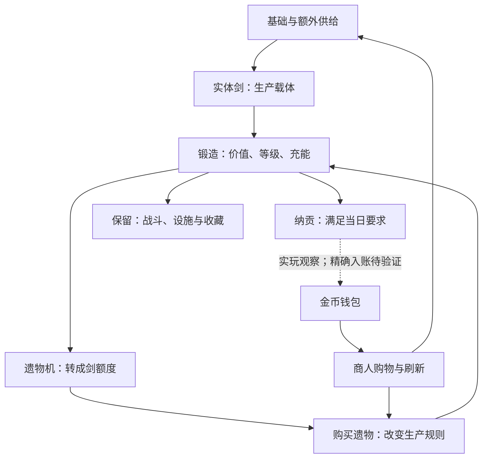
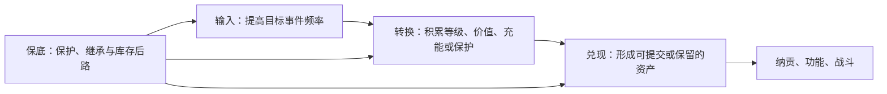

# ForgeTax（铸剑纳贡）
## 深度玩法拆解与项目系统分析

**研究基准：2026年11月17日｜以2026年11月12日大型更新后的Steam PC版本为主体**

**文档用途：**供主策划、系统策划、数值策划及研发团队研究原作的玩法结构、决策链与系统接口。本文件是对现有游戏的研究拆解，不是开发者内部设计文档，也不是另一款游戏的立项方案。

**阅读提示：**正文覆盖新版的锻造、纳贡、遗物、商人、剑系、工坊扩建、巨龙战斗、结局与无尽循环；旧版已公开的详细遗物数值单列为历史样本，不与新版配置混写。

---

## 研究口径与证据等级

本次读取Steam官方商店数据与13篇官方更新公告，覆盖2026年10月1日至11月12日；结合官方5张商店截图的文字识别、10月旧版实玩文章及社区机制研究进行交叉核验。没有购买、安装或亲自操作本作，没有进行代码逆向或MOD测试。

| 标记 | 含义 | 使用方式 |
|---|---|---|
| 【官方·现行】 | 最新公告或当前商店接口明确支持的事实 | 可作为本次拆解的主干；商店宣传与新公告冲突时，以更新公告为准 |
| 【官方·历史】 | 官方在特定旧版本公开的规则或数值 | 用于解释机制演进和构筑样本；不能直接作为新版实现参数 |
| 【实玩／社区】 | 媒体作者实玩、社区研究或截图识别 | 作为观察与验证线索；标注版本、样本与局面限制 |
| 【设计分析】 | 根据已证实机制进行的策划推导 | 是分析模型，不声称等于游戏源码、开发者意图或玩家总体行为 |
| 【待验证】 | 现有公开证据无法确认的规则或参数 | 不补造；列入末章的实机验证清单 |

引用使用[S01]—[S13]对应文末资料索引。正文的公式、流程图和状态模型凡未有直接实证，均属于【设计分析】。图为分析示意，不是原作截图，不代表原作界面布局。

## 01｜核心结论：这不是传统打铁经营，而是“生产型概率构筑”

### 1.1 一句话定义

**ForgeTax把“可能碎掉的装备强化”变成一局可构筑的生产游戏：玩家用有限的剑承担风险，用遗物改造结果分布，再以纳贡压力迫使自己在增长、兑现和保留之间作决定；新版进一步把保留的宝剑转化为战斗与工坊功能。**【设计分析】

锻造是高频操作，构筑是中层策略，纳贡是周期性经济检查，巨龙则同时承担债主、失败威胁与终局对手的叙事功能。它不是以精准落锤、材料冶炼配方或生产线调度为主的写实铁匠模拟。

### 1.2 六个决定游戏性的支点

| 支点 | 可观察的系统基础 | 策划价值 |
|---|---|---|
| 每一锤都是可停止的冒险 | 锻造可提升价值，也可能破坏整把剑 | 把一个按钮转化为连续的止盈判断 |
| 结果分布可以构筑 | 遗物改变结果签、保护和收益 | 玩家不仅承受随机，还能投资于随机结构 |
| 成长与生存争夺同一资产 | 剑既能换遗物，也能纳贡 | 升级没有完全独立的“免费预算” |
| 入神形成短时释放 | 同剑充能后进入免碎窗口 | 从谨慎敲击切换为集中产出，形成节奏落差 |
| 剑的身份与价值分离 | 剑系、强化、价值与终形技能并存 | 同样能纳贡的两把剑，保留价值可以不同 |
| 新版补上用途兑现 | 特殊剑用于设施、生命与巨龙战斗 | 天价数字开始有支付之外的功能和情绪回报 |

### 1.3 最值得借鉴的设计，不是“提高大成功率”

本作最值得研究的是三个闭环：

- **风险闭环：**可见风险 → 一锤决策 → 结果反馈 → 更新下一锤判断。
- **资源闭环：**实体剑 → 生存支付或构筑投资 → 更强生产能力 → 下一轮剑的分配。
- **情绪闭环：**被迫进贡 → 积攒强剑与能力 → 用自己的作品反抗巨龙。

如果只复刻高倍率、碎剑和免碎连点，会留下大量刺激而很少策略。真正需要复刻的是资产用途冲突、可控风险工具和阶段性兑现结构。【设计分析】

## 02｜产品档案与版本基线

### 2.1 当前产品档案

| 项目 | 调研结果 |
|---|---|
| 正式产品名 | ForgeTax；本文沿用用户熟悉的中文称呼“铸剑纳贡”，不宣称其为Steam唯一官方中文名 |
| Steam App ID | 5245810 |
| 开发／发行 | GraveYardDev |
| 发售日期 | 2026年9月29日，Steam中国区接口日期 |
| 产品类型 | 单人、黑暗风格、第一人称锻造轻度Rogue；商店类型含休闲、独立、模拟、策略 |
| 当前平台 | Windows、macOS；Linux未列为支持平台 |
| 中国区价格 | 调研时原价与现价均为人民币15元；价格不是永久承诺 |
| 语言 | 当前商店列出10种语言，包含简体中文、繁体中文与11月新增越南语 |
| 平台功能 | Steam成就、Steam云、家庭共享；商店接口列出19项成就 |
| 最新公开重大版本 | 2026年11月12日大型更新；不以第三方下载站的Build编号作为官方版本号 |

以上为【官方·现行】，见[S01][S02]。价格和成就数量为调研时快照。没有取得可靠的现时销量、退款率、留存率或新版好评率，本文不提供收入推算。

### 2.2 关键版本演进

| 时间 | 官方明确的变化 | 对拆解的影响 |
|---|---|---|
| 9月29日 | Steam发售 | 只能确认发布日期，不能据此推定首日所有配置 |
| 10月1日 | 契约30天改21天；终日基础要求145,000G；怒气第三阶段死亡；欠贡次日少一把剑 | 是早期规则，后续供剑惩罚已变更 |
| 10月4日 | 新增葬仪剑、8件成就解锁遗物；成就总数到19；铁砧主动道具简化为5种 | 构筑与局外发现扩大；多种旧消耗品停止出售 |
| 10月6日重做 | 免费起始遗物三选一；上限+30改+99；大成功价值倍率3×改2.5×；第21日基础要求232,000G | 旧文章中的倍率、上限与税额可能过期 |
| 10月6日热修 | 欠贡次日仍给3把基础剑；强化断剑继承与防护，改善早期恢复 | “欠贡就少发剑”不应继续作为后来旧版事实 |
| 10月7日至21日 | 明确遗物显示、回溯；修复堆剑、复制、存档与物理碰撞 | 说明资产管理与反馈透明度是实际系统问题 |
| 11月12日 | 24天；+299；每3级变形、+30终形；取消加热；战斗、新结局、无尽再战、工坊设施、遗物与商人重做 | 本文主版本；旧版税表、遗物参数、剑形态节点不能直接套用 |

【官方·历史／现行】见[S02]—[S10]。11月更新需要重开一局，但保留成就、图鉴发现与解锁和设置；旧局存档保留，不能在新版继续，官方提供legacy旧版分支。

### 2.3 宣传素材滞后的处理

调研时商店正文仍写“把剑烧热”，截图出现大成功3×／3.5×等旧表现；11月12日公告已明确无需加热，且重新调整进程、票池和遗物。**商店素材可证明玩法包装和界面信息，不能自动证明新版参数。**[S01][S02][S12]

## 03｜项目定位与体验边界

### 3.1 玩家实际扮演的角色

表层身份是囚禁中的铁匠，实际决策身份更接近**有限资产的风险生产者**：决定哪把剑继续加工、何时退出、拿什么投资、用什么支付，以及哪些作品不能交出去。【设计分析】

与传统经营游戏相比，本作的经营对象不是顾客满意度、工人排班或产线物流，而是“单位剑的价值潜力、存活机会和用途分配”。

### 3.2 体验定位

| 体验维度 | 本作主要承载点 | 不宜误认的内容 |
|---|---|---|
| 工匠代入 | 第一人称持剑、铁砧、挥锤、火花和金属反馈 | 没有证据证明具有复杂冶金、淬火温度或重心打磨规则 |
| 风险策略 | 破坏、停止、保护、回溯、库存底线 | 不等于每次失败都由手法失误造成 |
| 构筑成长 | 签分布、结果触发、继承、充能、倍率与经济效果 | 不是简单叠攻击力的战斗装备系统 |
| 收集满足 | 剑系形态、图鉴发现、解锁、展示与储存 | 图鉴发现不等于永久属性成长 |
| 终局释放 | 自制武器挑战巨龙，结局与再战 | 不能据此把全局定位改成以动作战斗为主的ARPG |

### 3.3 适配与排斥的人群

【设计分析】可能较适配喜欢局内连锁、爆发数值、可见风险和短周期实验的玩家；对损失高度敏感、追求稳定线性养成或严谨工艺模拟的玩家，可能与其核心体验不匹配。此处是定位推断，不是用户画像调查。

低价、小场景和高频操作降低了尝试门槛，但不代表其制作成本、买量成本或用户耐心可以直接由价格推出。

## 04｜玩法循环与系统架构

### 4.1 三层循环

```mermaid
flowchart LR
  subgraph 微循环：单把剑
    A[观察风险与充能] --> B[敲击或使用保护]
    B --> C[结果与遗物触发]
    C --> D[继续或退出]
    D --> A
  end
  subgraph 中循环：当日
    E[取得与分配实体剑] --> F[锻造与构筑投资]
    F --> G[纳贡或保留]
    G --> H[日终与下一日]
    H --> E
  end
  subgraph 大循环：整局与局外
    I[随机构筑与解锁内容] --> J[24天契约推进]
    J --> K[强剑准备与巨龙战斗]
    K --> L[结局、无尽或重开]
    L --> I
  end
```

图1为玩法分析示意，非原作强制流程。

| 层级 | 主要输入 | 玩家决策 | 主要输出 |
|---|---|---|---|
| 微循环：单把剑 | 剑状态、当前签与概率、遗物、道具、充能 | 敲、保护、回溯、取走或换剑 | 价值变化、等级变化、破坏、充能、条件效果 |
| 中循环：当日 | 供剑、库存、商店、当日／次日贡额 | 投资与贡品分配、保留武器、是否结束当天 | 贡品兑现、怒气变化、资金与成长、下一日 |
| 大循环：整局与局外 | 随机可用构筑、图鉴解锁、契约进度 | 成型路线、终局剑准备、无尽或重开 | 战斗与结局、记录、发现与新增内容入口 |

### 4.2 核心因果链

**不是“敲得越多就必然越值钱”，而是：**更多敲击 → 更多随机事件与触发机会 → 在存活和构筑成立的条件下提高潜在收益 → 同时暴露于更多损失机会。

因此，“价值越高，风险越高”只是很多局面里的相关现象。官方旧公告把基础破坏曲线明确关联强化等级，而不是直接关联显示剑值；同一等级的高基础价值剑不能仅因更值钱就被推定更容易碎。[S04]

### 4.3 系统依赖图的阅读方式



图2为资源分析示意；实体剑、剑额度与金币分账。

图中实体剑是核心资产；剑额度是购买遗物的账本单位；金币是另一种资金。纳贡如何精确转换成金币，公开官方资料没有完整公式，图中特别标为实玩观察和待验证接口。不能将三种资源的数值直接相加。

## 05｜单日流程与关键决策门

### 5.1 单日行为流程

| 步骤 | 行为与已知基础 | 关键判断 |
|---|---|---|
| 进入当日 | 查看契约进度、贡额、库存、商店与可用保护 | 先确定今日能否生存，再决定投资幅度 |
| 选择生产载体 | 从库存或供给中取剑；新版直接上砧 | 选择贡品剑、构筑材料剑，还是准备保留的功能／战斗剑 |
| 普通锻造 | 检查当前概率、充能、价值、等级和保护 | 下一锤的损失是否会让今天无法结算 |
| 入神生产 | 满足触发条件后进入短时窗口 | 是否集中道具与收益组件，提高安全窗口产出 |
| 决定退出 | 取走、储存、投入遗物机或放贡台 | 退出不是失败，而是把概率资产变成可分配资产 |
| 商店投资 | 消耗剑额度／金币；新版有永久增签与扩槽物品 | 买入是否能在未来回合回本，是否让当前生产预算断裂 |
| 日终承诺 | 核对贡台价值，敲铃推进 | 今日兑现与明日储备是否都可接受 |

此表为【设计分析】，不是原作强制执行的任务顺序。商人并非已证实每天出现，投资行为取决于其实际到访和库存。

### 5.2 三个“不能只看剑值”的节点

1. **继续敲击：**还要看当前充能、保护、剩余可锻剑和今日支付缺口。
2. **购买遗物：**还要看槽位、未来生产次数、组件互补性和供剑数量。
3. **提交贡品：**还要看该剑是否有战斗技能、生命奖励或设施用途。

### 5.3 三剑预算示例

【设计分析·演示值，不是首日实装配置】假设库存只有三把剑A、B、C，当日要求10,000G：A值12,000G，B值1,000G，C值800G。

- A可以独立支付今天，但若A是拟保留的终形武器，提交会失去终局准备。
- 把B投入遗物机可能获得购买额度，但会失去一把备用生产载体；不能假定C单独安全覆盖今日。
- 继续敲A可能增加未来资金，也可能直接毁掉唯一足额贡品。
- 一个合理的处理方向是先以B或C承担“可失败的生产尝试”，不要因为A已达标就认定必须继续敲A。

上述只说明资产角色的冲突，不给出无条件最优策略。真正的最优解还依赖遗物、供给、失误代价及战斗收益。

## 06｜锻造系统：结果、状态与价值

### 6.1 五类结果

| 结果 | 公开资料支持的语义 | 需要保留的规则边界 |
|---|---|---|
| 破坏 Break／Destruction | 剑破碎，常规情况下失去该生产载体；可被保护、继承或废料机制改写 | “破坏”不必等于所有派生收益归零 |
| 损伤 Damage | 旧版通常降强化并减值 | 即使+0或阻止降级，旧版损伤触发遗物仍可生效 |
| 维持 Hold | 旧版基础等级不变 | 遗物可以把维持转为价值、额外强化或充能 |
| 成功 Success | 提高强化／价值 | 新版完整基础倍率未公开，不能直接用旧媒体1.5×定稿 |
| 大成功 Great | 高收益结果，旧版可获得额外等级和倍率 | 旧官方2.5×是10月版本值；与追加等级如何叠算必须分开核验 |

五结果与界面可见概率受到商店截图和多份资料支持；默认逐项等级变化细节主要来自旧实玩／社区。新版公告称结果签分布与遗物重做，并未完整重述基础计算。[S01][S02][S04][S11][S12]

### 6.2 建议的分析状态模型

为了讨论系统，可把单把剑状态写成：

**SwordState = {剑系、基础价值、当前价值、历史峰值、强化等级、外观阶段、入神充能、入神剩余时间、锻造次数、结果计数、暂存收益、保护、功能状态}。**【设计分析】

这不是反编译得到的数据结构。其中“历史峰值”有旧版送葬者圣杯的明确需求；“暂存收益”有封印之心、败王玉玺等旧版延迟兑现规则的支持；新版实际字段和实现形式未知。

### 6.3 一锤的分析结算顺序

**输入检查 → 形成最终概率 → 抽取结果 → 检查适用保护 → 执行基础结果 → 执行触发／暂存收益 → 更新等级、价值、充能与形态 → 展示结果与下一锤状态。**【设计分析】

这一顺序是研发沟通模型。真实保护优先级、入神触发锤的免碎生效时点、事件转化后的触发类别、回溯是否恢复全部派生变量，需要实机确认。

### 6.4 等级、价值、形态必须分离

- **等级：**与成长节点、部分触发门槛和基础风险相关。
- **价值：**决定贡品支付能力，新版影响战斗表现；可以受到额外收益组件影响。
- **形态：**新版每3级变化，+30到终形；+31至+299仍可强化，但不应杜撰每3级继续有新模型。
- **剑系：**决定终形能力与部分非战斗用途。

不能把“+30终形”写成强化上限，也不能把“+299”推导为300套外观。[S02]

## 07｜抽签与概率构筑

### 7.1 两个层级：签数不等于最终概率

旧官方区分墙面显示的抽签票数与铁砧上最终强化概率：前者显示参与抽签的数量，后者显示当前剑的最终概率。[S06]

社区把其描述为基础签数、等级权重、减免和最终离散判定的多层组合，提及30张基础签与1000格整数判定。此处是【社区研究】，**不是新版固定30签的官方配置证据**；11月公告又调整结果签分布。[S02][S13]

### 7.2 四类对概率的操作

| 操作层 | 对决策的作用 | 典型区别 |
|---|---|---|
| 增加结果签 | 增加某类结果的相对机会 | 增加成功签不等于成功率直接加固定百分点 |
| 移除基础签 | 改变池子结构，间接影响其余比例 | 新版Fate-Carving Knife明确属于这一类，精确移除规则待验证 |
| 当前剑／下一锤修正 | 局部改变可用结果或概率 | 与本局永久增签的作用范围不同 |
| 结果保护／转换 | 抽到不利结果后降低损失 | 表面破坏率不变，也可能降低实际资产损失率 |

“把概率做低”和“把损失抵消”是不同维度。前者改变事件发生频率，后者改变结果严重性。

### 7.3 签池演示

【设计分析·演示值】若A类结果4签、其余共6签，在所有签权重相同的简化模型中，A概率为40%。增加2张A签后是6／12＝50%，不是60%；若改为移除2张非A签，则是4／8＝50%。

两种操作此时比例相同，但池子组成与未来遗物触发可能不同。本作存在等级与遗物修正，不能用这个简化等权模型直接算实装概率。

### 7.4 相对减免与百分点

旧官方明确例子：40%破坏概率降低15%后是34%，不是25%。[S04]

若为了分析暂设两项15%和25%减免依次乘算，则40%×0.85×0.75＝25.5%。**这一组合乘算是演示假设，不是对任意新版遗物叠加规则的确认。**

当文案只写“破坏概率-10%”时，策划必须明确是相对减免、百分点降低、减票还是结果保护。否则玩家理解、UI显示与真实判定会产生三套口径。

### 7.5 概率透明不等于体验公平

明牌概率降低的是信息不对称，不会消除连续失败。一次10%风险连续经历多次，累计损失机会仍然明显增加；在有限库存下，运气不佳可以造成无法恢复的生产断裂。

因此应从“能否提前知道风险”进一步观察“能否主动降低风险、保留后路、理解失败和快速重新决策”。这比简单争论随机是否真实更有策划价值。【设计分析】

## 08｜入神：从风险累积到安全产能

### 8.1 已确认的基本结构

当前商店仍明确：**同一把剑锻造10次充满入神，下一次敲击触发，进入短暂不会破碎的窗口。**不是十次成功，也不是自动在第十次立即开始。[S01]

11月新版Dopamine Syringe会改变入神的风险与收益，因此不能把基础窗口规则无条件套到所有构筑。[S02]

### 8.2 尚未闭合的参数

| 参数 | 当前研究结论 |
|---|---|
| 基础持续秒数 | 官方资料未给精确秒数；旧攻略常写4秒，截图可见3.5s倒计时，不足以确定初始时长 |
| 入神自带加速 | 10月6日官方明确取消基础加速，遗物加速另算；新版是否有其他条件修正需实机 |
| 是否免损伤／维持 | 旧资料指向仅免破坏，不能写成全面必成功 |
| 触发锤是否立即免碎 | 商店语句不能完全解决结算先后，需逐帧或规则页确认 |
| 能否再次充能与连续触发 | 精确刷新、保留、延长和重触发规则待验证 |
| 道具充能如何跨状态处理 | 旧商人道具与新版构筑有差异，不能推定所有充能用途一致 |

### 8.3 入神的策略价值

它把策略从“找到一把永不失败的剑”转成“怎样让有潜力的剑走到释放窗口”。保护、充能、继承、延长时间和攻速各对应不同环节：

- 保护：提高抵达窗口的存活率。
- 充能：减少需要暴露的普通锤次数。
- 继承：让下一把剑更接近有收益的状态。
- 延时与锻造速度：提高窗口内有效敲击数。
- 收益与结果签：提高每次有效敲击的产出。

【设计分析】窗口总价值不是只看时长，而是“抵达概率×窗口有效锤数×每锤收益×兑现率”。其中每项都可能受不同组件限制。

### 8.4 存活率演示

【设计分析·固定概率假设】若每次普通锤破坏率恒为20%，且没有保护，存活10锤概率为0.8的10次方，约10.74%；若只需承受6锤且每锤风险10%，存活率约53.14%。

原作概率会随状态变化，以上不能用于预测一局真实胜率；它只说明“减少暴露次数”和“降低单锤风险”可以同时放大抵达窗口的机会。

## 09｜剑资产：生产载体、支付物与终局工具

### 9.1 新版剑的多用途

| 用途 | 官方支持 | 资产管理上的影响 |
|---|---|---|
| 生产载体 | 直接上砧锻造 | 保留一把剑就是保留一条未来生产路径 |
| 贡品 | 放贡台、敲铃满足巨龙要求 | 价值在结算时兑现为生存进度 |
| 遗物购买材料 | 售货机收剑，不收金币 | 实体剑从当前支付能力转换为未来生产能力 |
| 战斗武器 | 价值影响战斗，终形有独特技能 | 高价值剑不必全部交出去 |
| 生命收益来源 | 某些海鲜剑纳贡增加最大生命次数 | 剑的额外用途与贡品支付结合 |
| 保护来源 | 高阶圣剑可概率抵消破坏 | 剑自身可参与生产防护，不再只有遗物能干预 |
| 概率成长来源 | 世界树随日数增加结果签 | 日期推进成为剑效果的输入 |
| 设施材料 | 特定城塞剑开附楼，特定葬仪剑装灵魂铃 | 投资不只买遗物，也可改变工坊能力 |

【官方·现行】见[S01][S02]。每一项的具体剑名、门槛、数量、消耗与永久性不能超出公告直接支持的范围。

### 9.2 可识别的剑系

当前成就展示与官方公告可识别城塞、圣剑、锯剑、龙牙、符文、分裂、世界树、鱼剑及葬仪剑等称谓。[S01][S02][S05]

这不是完整武器数据库，也不证明每个展示成就一一对应独立终形技能。光束、刀刃齐射、骷髅军团是官方明确展示的能力类型，但本次没有取得完整“剑系—技能—倍率—冷却”映射。

### 9.3 生命周期

**获得 → 放置／持有 → 锻造与触发 → 形成用途差异 → 纳贡／投入遗物机／保留／设施使用／战斗 → 消耗或继续存在。**【设计分析】

持有、放地、剑架、贡台、铁砧与复制待放置队列是不同空间状态。旧官方已确认未纳贡的铁砧剑可以保留到下一日，复制待放置队列会保存并跨日保留。[S07][S09]

### 9.4 保留决策

对每把剑，至少应分开计算：贡品贡献、替代它的生产成本、剑额度用途、战斗用途、设施用途和收藏偏好。若只按价值排序，很可能把功能稀缺的剑误交出去。

新版真正增加的是**用途异质性**，不是单纯增加剑的种类。一个只能支付的作品与一个能解锁商人刷新能力的作品，决定了不同的经营路线。【设计分析】

## 10｜遗物系统：从词条到结果引擎

### 10.1 新版已证实的结构

11月公告明确重做遗物效果、价格、稀有度、出现条件与组合，降低同日反复出现物品的权重，改善早中后期货池。[S02]

| 新版明确新增 | 已确认功能 | 不能擅自补充的部分 |
|---|---|---|
| Dawn-Restored Holy Sword | 收集两个组件形成的融合遗物 | 两组件名称、获取次序、占槽、是否消耗和融合效果 |
| Fate-Carving Knife | 移除基础结果签 | 选择哪类、每次删多少、最低剩余签数与持续范围 |
| Dopamine Syringe | 改变入神风险与收益 | 是否允许破坏、倍率、持续时间和具体代价 |
| 保护显示改进 | 更清晰地显示剩余次数与下一项生效保护 | 真实优先级公式与可否手动调整 |

英文名称以公告原文为准，避免把非官方中文译名写成游戏内的唯一名称。

### 10.2 功能分类

| 类别 | 修改对象 | 典型的策略问题 |
|---|---|---|
| 分布类 | 结果签与临时概率 | 需要更多好结果，还是需要某个“坏结果”作为触发器 |
| 收益类 | 当前值、基础值或事件增益 | 频率与收益是否同时满足，是否重复乘算 |
| 等级类 | 成功、维持、损伤后的额外等级 | 是否能绕过基础结果的弱收益 |
| 充能类 | 抵达入神的锤数与准备 | 是否降低危险路段长度 |
| 窗口类 | 入神时长、速度和结果 | 是否存在低抵达率但高爆发的失衡 |
| 防护类 | 破坏的后果 | 使用次数、适用剑、优先级和损失代价如何管理 |
| 继承类 | 破坏后下一把剑 | 是损失回收，还是可以主动建立循环 |
| 经济类 | 剑额度、金币、刷新、供给 | 是否改善当前和未来两种生产预算 |

此分类为【设计分析】，不表示新版完整遗物库都已取得。

### 10.3 历史数值样本A：结果转化与延迟兑现

**本表全部为10月6日官方旧版值。11月全面重做后需重新核验，不可直接作现行攻略。**[S03][S04]

| 遗物 | 历史规则 | 可研究的设计结构 |
|---|---|---|
| Cracked Splice | 每次损伤降低该剑破坏概率15%，最多60% | 负面结果转为安全储备；“15%”为相对减免口径 |
| Defeated King's Seal | 每次损伤为下一次大成功追加+1级 | 把损伤计数变为待兑现收益 |
| Sealed Heart | 每次维持为下一次大成功追加+1级，最多+4 | 无收益结果转为储能，但需要兑现事件 |
| Sleeping Ember | 每次维持有70%概率获得+1级 | 改变“维持”的基础语义 |
| Unbroken Oath | 每次损伤有70%概率获得+1级 | 降级与追加升级可以同时存在，需看最终净效果 |
| Ossuary King's Scabbard | +7及以上剑破坏，本局永久增加1张其前一个结果的签 | 破坏能够反向塑造以后结果分布 |
| Mourning Knot | 每次欠贡，本局永久增加1张大成功签 | 用生存压力交换长线概率收益 |
| Glass Hourglass | 入神中的大成功获得+3级 | 把概率命中与窗口收益绑定 |

旧官方还明确：本局永久获得的签在丢弃遗物后保留，新局清零；+0或阻止降级也不阻止损伤触发。这两项使“持有时效果”与“已写入的局内成长”成为不同层级。[S04]

### 10.4 历史数值样本B：恢复、供给与经济

| 遗物 | 历史规则 | 规则注意点 |
|---|---|---|
| Broken Holy Sword | 热修后继承断剑强化的30%，赋予3点入神充能 | 原先20%已被同日热修替代；作用于下一把未锻造+0剑 |
| Dawn Scabbard | 继承40%，继承时获得4点充能 | 与上项旧版明确相加至70%／7充能；取整待验证 |
| Undertaker's Chalice | 断剑历史峰值30%作为废料贡品；价格1剑，第2日起可出现 | 是自动派生贡品，不应伪装成重新获得实体剑 |
| Worn Voucher | 每回合一次免费遗物店刷新 | 免费次数不等于免费购买遗物 |
| Ash Sieve | 断剑获得500G | 金币收益，不是剑额度；现行是否仍在池待验证 |
| Tax Tally | 每次足额纳贡，获得1点遗物店剑额度 | 不是每日额外发一把实体剑 |
| Dragonscale Tongs | +6及以上剑破坏概率相对降低25% | 旧20%已热修为25% |
| Lightning Mark | 非入神大成功后，下一锤破坏概率相对降低40% | 只作用下一锤，不是永久防护 |
| Phoenix Ash | 阻止破坏时损失40%剑值 | 旧50%已热修为40%；具体次数未由该公告完整重述 |

【官方·历史】见[S03][S04]。这些样本证明本作已存在互补的结果、计数与恢复设计，但不证明新版所有名称与参数都保留。

## 11｜构筑拆解：必须有“输入—转换—兑现—保底”



图3为构筑分析示意，不是现行保胜配方。

### 11.1 构筑不是高强度词条集合

有效构筑至少回答四个问题：

1. **输入：**怎样提高目标事件出现频率？
2. **转换：**事件怎样累积等级、价值、充能或保护？
3. **兑现：**暂存收益通过什么事件变成可用资产？
4. **保底：**兑现前剑毁掉或欠贡时，有什么恢复路径？

一个增加损伤的组件如果没有减损、收益或保护转换，只会增加负收益；一个高额大成功收益组件如果很少命中且不能抵达入神，也不一定提高生存能力。【设计分析】

### 11.2 五种可研究的机制路线

**下表是基于历史样本与新版方向提出的构筑分析，不是已实测的现行保胜配方。**

| 路线 | 输入／转换／兑现链 | 长处 | 容易失效的地方 |
|---|---|---|---|
| 入神爆发 | 保护或充能 → 更快抵达窗口 → 延时／速度／收益 → 高价值剑 | 明确的准备与释放，产能集中 | 缺少抵达保障；只堆窗口而忽略普通锤风险 |
| 维持储能 | 增加维持 → 追加等级或暂存奖励 → 大成功兑现 | 原本空转结果可以变成长 | 没有兑现事件，暂存收益无法支付贡额 |
| 损伤转化 | 损伤频率 → 减损／安全累积／追加等级 → 价值增长 | 让不利结果具有构筑价值 | 把触发概率误当净收益；未处理破坏与降级 |
| 断剑继承 | 高潜力剑破坏 → 等级／充能继承 → 新剑更快成型 | 失败可以缩短下一次启动 | 库存不足；继承门槛不符；当前支付仍断裂 |
| 经济与票池 | 纳贡／损失／刷新 → 剑额度或永久签 → 稳定访问强组件 | 改善后续生产环境与选择权 | 为长线收益花掉当日全部剑；回本时间超过余下契约 |

### 11.3 槽位稀缺性

基础容量8槽，第18天起可在商人找到增加至9槽的物品。【官方·现行】[S02]

第九槽不是仅增加12.5%的词条数量；如果前8槽恰好缺少保底或兑现组件，它可能解除构筑瓶颈。反之，若第九件只是同类加值，收益可能小于恢复一个被替换的关键组件。

### 11.4 替换一个遗物应看净效果

【设计分析】建议以“未来可用剑数×单剑成功兑现率×有效价值”比较替换前后，而不是只比显示倍率。

需要额外核对：旧永久票是否已写入、当前剑暂存计数是否消失、保护还有几次、某个组件是否是唯一兑现器，以及新遗物是否必须等到下一次供给才生效。

## 12｜资源经济：三种账本与两个时间尺度

### 12.1 资源定义

| 资源 | 主要入口 | 主要出口 | 核心作用 |
|---|---|---|---|
| 实体剑 | 基础供给、商人、额外供给／复制效果 | 纳贡、遗物机投入、破坏；设施用途是否消耗需核验 | 生产、生存、构筑、战斗的共同载体 |
| 遗物店剑额度 | 剑投入；旧Tax Tally等效果 | 购买遗物及可能的兑换操作 | 把实体剑转成构筑购买单位 |
| 金币G | 实玩观察的纳贡所得；旧断剑收益等 | 刷新与商人购物 | 购买选择权、补给和风险工具 |
| 入神充能 | 同剑锻造与条件效果 | 达到触发与状态消耗 | 开启高收益窗口 |
| 龙怒警告 | 旧版欠贡提高警告、降怒恢复 | 旧版达到第三阶段致死 | 与新版生命次数、战斗HP的关系待验证 |
| 生命次数（lives） | 新版部分海鲜剑纳贡增加最大生命次数 | 次数如何消耗尚未确认 | 不直接等同战斗HP或旧龙怒阶段 |
| 战斗HP | 已确认有战斗，但具体生命界面与数值未取得 | 受击和失败规则需实机 | 不据“maximum lives”补造HP系统 |
| 本局永久签 | 历史遗物，新版商人增签商品 | 通常随新局清零 | 构成局内长期生产环境 |

“G”也出现在剑的贡品价值上，不能据单位同名就把价值显示等同钱包余额。官方曾专门澄清实物剑、剑额度、免费刷新等通知的区别。[S04]

### 12.2 当前与未来的双预算

- **当日预算：**足够的可用剑、贡品价值和恢复次数，防止本日被打断。
- **跨日预算：**遗物、永久签、库存和设施，决定未来增长与终局准备。

遗物购买把今天的资产转换成以后收益。越临近契约终点，可回本的回合越少；终局武器则可能带来非贡品收益，不能用同一回本口径评价。【设计分析】

### 12.3 分账的分析方程

**下一日实体库存＝本日可用库存＋新获得的实体剑－已提交剑－投入遗物机剑－真实破坏剑－确认消耗的功能剑。**

**下一日剑额度＝现有额度＋投入所得额度＋效果额外额度－遗物购买额度。**

**下一日金币＝现有金币＋已确认金币收益－刷新成本－商人购买成本。**

以上为【设计分析】账本模型，具体结算时间由实装决定。保护把破坏转化成损伤时，不计入“真实破坏剑”；复制尚在待放队列时，应与地面实体库存分列；未知的设施消耗不能直接扣除。

### 12.4 稀缺资源的影子价格

一把800G的旧剑在今日富余时，可能只是廉价遗物材料；若今日只剩这把可继续敲，它的生产选择价值远大于800G。固定“一剑”购买成本天然把剑数与剑价分开，产生以低价剑投资、以高价剑支付的动机。

但“所有剑投入都给相同额度”“所有遗物只卖一剑”并未得到新版完整证明，不应写成普遍定律。【设计分析／待验证】

## 13｜纳贡、龙怒与契约推进

### 13.1 纳贡系统的主要接口

| 接口 | 已知事实 | 未确认的细节 |
|---|---|---|
| 贡台与铃 | 放剑并敲铃提交 | 是否有二次确认、最后可撤回时点 |
| 当日要求 | 满足价值要求延续生存 | 新版24日完整基础表、特殊修正和结算取整 |
| 次日预测 | 旧官方明确可查看明日要求 | 新版所有界面的实际呈现位置 |
| 警告 | 旧官方三阶段怒气，第三阶段死亡 | 新版与最大生命次数、战斗HP之间关系 |
| 恢复 | 旧香炉降怒，旧热修欠贡后仍供3剑 | 当前降怒工具与供剑规则的完整表 |
| 契约结束 | 新版终日提醒备好强剑，加入战斗与结局 | 精确触发先后、失败后处理和可能分支 |

[S01][S02][S03][S05][S09]

### 13.2 怒气不是每天必须完全足额的硬失败

10月1日官方说明，短缺提高怒气，达到第三阶段死亡；最终日短缺但未达到致死阶段，当时仍可算完成契约。10月6日热修恢复欠贡后的3把基础剑，但怒气仍累积。[S03][S09]

这说明旧版存在**以警告空间换取恢复与增长时间**的机制，而不是单次欠贡立即死亡。新版是否保留相同完成判定、最大生命次数如何改变容错，不能沿用旧结论。

### 13.3 不伪造完整贡额曲线

| 已公开的历史节点 | 数值 | 使用限制 |
|---|---|---|
| 10月1日21天契约终日 | 145,000G | 官方历史基础要求 |
| 10月6日21天契约终日 | 232,000G | 官方历史重做要求 |
| 11月12日24天契约 | 官方确认重新调整贡额 | 完整24日数表未取得，不能插值伪造 |
| 商店截图某局面 | 2,600G | 只代表截图局面，不能认定首日或新版默认值 |

### 13.4 判定难度应看覆盖率

【设计分析】设今日贡台已可用价值为P，当日要求为Q，可观察覆盖率C＝P／Q。

- C大于等于1：今天已有支付能力，但未必有战斗或明日储备。
- C小于1：还有缺口；高风险锤的意义取决于有没有替代剑与警告空间。
- C很大：当前税额已失去压力，游戏需要收藏、功能、构筑实验或战斗兑现继续驱动。

覆盖率只是局面指标，不是胜率；P必须只计今日确实可提交且未被玩家保留的资产。

## 14｜幽灵商人、消耗品与工坊投资

### 14.1 两种商店的角色差异

| 商店 | 核心支付单位 | 决策角色 |
|---|---|---|
| 遗物售货机 | 剑／剑额度 | 用当前生产资产换持续规则修改 |
| 幽灵商人 | 金币 | 用已兑现资金换补给、道具、特殊剑、永久签与扩槽 |

旧实玩文章说商人“每隔2天”，部分攻略说“每3天一次”；这可能是措辞或版本差异，本次未取得官方固定到访表，**不写死当前商人周期**。[S11]

### 14.2 新版商人库存与刷新

【官方·现行】商人新增本局永久增签物品；重新调整基础剑与特殊剑的库存、价格和强化等级。第18天起可以找到8→9槽扩容商品。灵魂铃允许每次商人到访刷新库存一次。[S02]

“从第18天起可找到”不等于第18天必出；“每次到访一次”不等于每日一次。购买与刷新规则应该以可用状态，而不是模糊日历直觉来说明。

### 14.3 旧版五种铁砧主动物品

| 物品 | 官方／实玩可确认的作用 | 本文边界 |
|---|---|---|
| Cracked Dragon Scale | 实玩截图：抵挡下一锤破坏，无论结果如何消耗；官方改为单片出售 | 完整新版效应与保护优先级待验证 |
| Regret Clockwork | 支持回溯上一锤；官方修复断剑后仍保留可回溯机会 | 回溯的随机状态、复制、保护和资产恢复范围需验证 |
| Red Chalk | 10月官方：下一锤大成功签翻倍 | 不等于大成功概率翻倍；现行是否改值待验证 |
| Powder Pouch | 10月官方确认是可在铁砧使用的物品之一 | 具体效果未取得可靠一手说明，不杜撰 |
| Cold Star Shard | 10月官方确认在铁砧可用；旧实玩指向推进入神 | 精确加点、时点与上限待验证 |

其他10月官方商品：Ghost Delivery Note购买后立即为下一次供给预订额外2把基础剑；Incense of Oblivion立即降怒一级，每局一次。它们不是铁砧五物品的同一清单。[S05][S10][S11]

### 14.4 工坊扩建

| 设施 | 官方确认的入口与功能 | 设计作用 |
|---|---|---|
| 附楼 Annex | 使用特定城塞剑开启，提供额外剑架与练习区 | 容量扩展，并给保留剑一个长期去处 |
| 灵魂铃 Soul Bell | 使用特定葬仪剑安装，每次商人到访刷新一次 | 把特殊剑价值变成持续库存选择能力 |
| 训练木人 | 测试剑技能与伤害 | 在终局前展示战斗收益，减少盲目保留 |
| 再战门 | 结局后安装，可再次挑战巨龙 | 为无尽增长提供重复的用途兑现 |

【官方·现行】[S02]。设施的消耗规则、费用、安装顺序、可否拆除和跨局保留没有公开完整表，不当作永久局外设施。

## 15｜巨龙战斗：新版补齐“作品的用途”

### 15.1 已证实的战斗骨架

| 模块 | 官方确认 |
|---|---|
| 进入前准备 | 最后一天纳贡前，备好自己最好的剑；提示“不要相信巨龙” |
| 武器成长映射 | 锻造剑的价值影响战斗 |
| 技能差异 | 各剑系终形具有独特能力；例子包括光束、刀刃齐射、骷髅军团 |
| 敌人表现 | 新增独立战斗区域、攻击模式、音乐和效果 |
| 结果 | 新增结局；结局后可进入无尽模式 |
| 重复挑战 | 工坊安装门后可再战巨龙 |
| 预演 | 附楼训练区木人可测技能与伤害 |

【官方·现行】[S02]。10月11日的御剑与巨龙视频是开发中原型，不作为11月最终攻击参数或动作清单。[S10]

### 15.2 战斗如何改写经济决策

旧版的强剑主要满足“交出去或继续升值”；新版增加“保留下来用于对抗”。于是最贵的剑不一定是最合适的贡品，最实用的剑也不一定是最高账面价值。

玩家需要解决一个新的选择：**用最强剑保证今天轻松过关，还是让其他剑承担贡税、把最强剑留作终局？**这让纳贡与战斗共享资产，避免终局战斗只是与前面玩法无关的附加关卡。【设计分析】

### 15.3 价值到战斗的数值接口风险

若贡品价值存在大规模复利增长，直接把剑值等比例转换成伤害，可能令战斗秒杀或数值溢出；过度压缩又可能让玩家觉得锻造收益没有兑现。

可研究的映射方式包括分段增长、对数压缩、软上限与技能强度独立维度，**但本次未取得游戏实际映射公式，以上是待研究的实现选择，不是原作规则。**

### 15.4 战斗尚不能细拆的内容

没有可靠证据确认：巨龙HP、各招式前摇与判定、战斗生命和龙怒关系、攻击按键、耐力／闪避／格挡、技能冷却、换剑、失败重试、再战是否强化巨龙、纳贡剑能否在战斗中追回。

因此本文能拆解的是战斗的系统位置与资产接口，不能伪造一份完整Boss技能设计表。若用于实际复刻，需优先补录新版实机。[S02]

## 16｜空间、交互与反馈设计

### 16.1 工坊是把抽象系统变成可见工作场所

| 空间节点 | 对应系统 | 玩家认知 |
|---|---|---|
| 铁砧 | 高频锻造与概率显示 | “在这里承担风险并创造价值” |
| 遗物机 | 投剑和购买规则能力 | “舍弃一把，换来以后更强的敲击” |
| 贡台与铃 | 日终支付和契约推进 | “在这里兑现并承诺结束当天” |
| 巨龙栏后 | 威胁与叙事目标 | “生产压力有一个具体施加者” |
| 幽灵商人 | 阶段性补给 | “资金可以买来新的选择” |
| 剑架与附楼 | 储存、收藏与准备 | “不交出去的作品也有位置与用途” |
| 训练区与再战门 | 战斗预演和再挑战 | “锻造出来的力量可以亲自使用” |

此表为【设计分析】，不是原作地图比例图。商店素材确认铁砧、贡台、遗物机和商人场景，新版公告补充附楼等设施。[S01][S02][S12]

### 16.2 信息层级

锻造决策至少需要同时可见：当前剑名／等级／价值、五类最终概率、充能或剩余时间、保护状态、上一锤结果与主要增益。全局则需提供钱包、当日缺口、明日要求和容错余量。

旧官方已专门优化当前剑增删签、继承数值、保护剩余次数、下一项生效保护，以及铁砧内查看遗物。[S02][S06]

这些信息不是装饰。若玩家必须离开铁砧才能查询关键保护，或者同一块显示混淆“签数”与“最终概率”，可控风险会变成记忆负担。

### 16.3 身体感与快速决策的冲突

搬剑和空间交互能提供工匠感，但重复搬运、堆剑碰撞、商人介绍镜头和纳贡等待会把策略密度稀释。11月取消加热、减少重复镜头与结算等待、增加冲刺，正是在压缩无新决策的流程段。[S02]

10月官方修复过剑堆被推过天花板、剑落地抖动、复制碰撞、放剑失败和存档载入问题。[S07][S08] 对本作来说，这不是边角体验：剑就是财富，拿不到的剑会表现为“资产损失”。

### 16.4 反馈应区分原因与结果

一个完整锻造反馈应该告诉玩家：抽到什么、是否被保护改写、消耗了哪项保护、是否触发追加增益、最终变化是多少、下次风险如何改变。

只显示“损伤”而不展示其带来的保护叠层，会让负面结果构筑难以理解；只显示“未破坏”而不告诉哪件保护耗尽，会使玩家误判下一锤。【设计分析】

## 17｜成长节奏、内容解锁与重开动力

### 17.1 阶段拆解

**以下早中后期为策划分析分段，不是官方固定关卡区间。只有第18天扩槽起点和24天契约是现行明确日期。**

| 阶段 | 应观察的主要决策 | 驱动点与风险 |
|---|---|---|
| 启动期 | 初始构筑、库存底线、第一次入神 | 需要让玩家看见“能改变风险”，避免未成型先失败 |
| 成型期 | 补足输入、兑现、保底组件 | 出现连锁与价值跳升；若必须刷某一件才玩得下去，会降低选择性 |
| 扩张期 | 特殊剑、永久票、设施与额外槽 | 生产之外的用途开始分化，投资回报需可感知 |
| 终局准备 | 贡品与战斗剑分配 | 不能所有好剑都当贡品交掉，情绪目标开始转向反抗 |
| 无尽期 | 更高贡额、收藏、构筑试验与再战 | 若只持续加税，可能退化为重复生产 |

### 17.2 局外成长的已知边界

图鉴发现、成就与解锁跨局保留；旧官方三存档槽共享图鉴发现与解锁。[S02][S04][S09]

没有可靠证据证明存在账号经验、永久技能树、职业等级、付费强化成功率或将超额贡品转换为永久经验。不能把图鉴解锁解释为永久基础属性提升。

### 17.3 图鉴：发现和解锁是两个状态

旧官方说明，物品在商店展示、取得、持有或解锁时即可发现名称与效果，购买不是必要条件；未发现显示黑影与问号，适用时显示解锁条件。新版新增发现、解锁、库存到达筛选，融合组件更易查询。[S02][S04]

因此：**看到并认识一个遗物，不等于以后一定能买到；达成解锁，也不等于立即获得。**货池到达、日数门槛、随机刷新和槽位还可能限制使用。

### 17.4 重开动力应来自不同解法

无尽数值只增加同一解法的工作量，不能单独保障复玩。新版的不同剑系能力、设施、永久票和融合组件提供了新的路线选择，但是否足够支撑多局，仍需实际体验与数据观察。【设计分析】

## 18｜数值与决策分析模型

### 18.1 单锤期望值只是起点

【设计分析】设五结果概率分别为pB、pD、pH、pS、pG，下一状态价值为VB、VD、VH、VS、VG，则：

**E[V下一锤]＝pB×VB＋pD×VD＋pH×VH＋pS×VS＋pG×VG。**

但有保护、继承、废料贡品、暂存等级和充能时，状态价值不能只用当前剑价；需要把恢复与未来机会一起纳入。

### 18.2 演示计算

【纯演示，不是原作参数】设当前价值1,000G，五概率为10%、15%、25%、40%、10%；结果价值分别为0、800、1,000、1,500、2,500G。

期望值＝0＋120＋250＋600＋250＝1,220G，单锤账面期望增加220G。

然而，若这把1,000G剑是唯一能支付今日1,000G要求的资产，下一锤有10%破坏和15%跌破要求的可能。**正期望不等于最适合生存，也不等于应该继续。**

### 18.3 资产效用而非单价最大化

可用一个抽象目标讨论局面：

**U＝当日存活价值＋未来生产选择价值＋终局战斗／功能价值－失败损失－操作耗时。**

它不是实装评分公式，而是提醒策划：止盈、备用剑、继承、扩建和战斗准备不是与“赚更多G”无关的附属行为。

### 18.4 收益叠加的四种危险误算

| 误算 | 为什么不成立 |
|---|---|
| 给大成功2.5×后再无条件追加两次完整成功倍率 | 等级变动与价值倍率可能属于同一结算，不能重复计算 |
| 大成功签翻倍＝大成功概率翻倍 | 分母也变化，并且可能有等级与临时权重 |
| 增加等级一定等比例增加实际剑值 | 价值有基础、历史增益或独立乘区的可能，需实测 |
| 多项减破坏直接相加至0 | 相对减免、百分点、减签和保护不同，不能合并口径 |

### 18.5 复利与数值上限

如果持续事件收益为乘法，价值增长可以远快于等级；强化到上限后，是否继续价值增长、触发计数和充能，官方没有完整现行说明。

不能把MOD或旧攻略出现的“1E+100G”认定为官方数值上限。复刻时必须单独测试大数显示、战斗映射、存档、结算和上限触发，不能只防普通整数溢出。【设计分析／待验证】

## 19｜设计问题、玩家反馈与版本应对

### 19.1 可确认的问题来自哪里

10月11日官方直接指出两类待改善体验：**构筑尚未享受到就提前结束，以及构筑成型后变得重复**；并计划改善早期恢复、入神、遗物身份、工坊管理与剑的特殊用途。[S10]

10月20日媒体实玩作者也批评阶段差异、构筑广度和图鉴复玩动力不足，同时认可入神爆发与遗物联动。[S11] 这是作者的小样本体验，不是Steam总体结论。

11月12日更新与这些方向相对应，但“推出修复”不等于“问题已被证明解决”。新版满意度、胜率和复玩数据仍需重新观察。

### 19.2 问题—机制—验证指标

| 问题 | 机制原因的分析 | 已见应对 | 仍需验证 |
|---|---|---|---|
| 早期被随机击穿 | 库存少，未形成恢复，投入遗物又减少可用剑 | 旧版恢复热修；新版前期货池重新组织 | 第一次有效构筑前失败率是否降低 |
| 旧版恢复手段过度依赖少数遗物 | 普通锤损失较强，可获取的替代恢复方案不足 | 官方强化继承与保底并调整出现权重 | 新版是否有多条可生存路线，不依赖单件 |
| 成型后重复 | 当前税额已被生产引擎覆盖，只需重复执行 | 战斗、特殊剑、设施、无尽再战 | 新用途是否改变决策，而非增加搬运 |
| 价值只有数字回报 | 强剑持续纳贡，没有亲自使用 | 价值影响战斗与终形能力 | 玩家能否感到锻造投入与战斗表现一致 |
| 信息难读 | 票数、最终概率、保护和继承混在一起 | 当前剑显示、保护次数、下一保护、Forge Notes | 玩家是否能准确解释失败原因 |
| 资产物理问题 | 堆剑、碰撞、复制和拾取失败 | 多次物理／保存优化、附楼 | 长局大量剑时资产是否可控和不卡顿 |

### 19.3 不用未核验的热度替代判断

本文不引用下载站的Steam好评率、在线峰值、销量估算或微信榜排名来判断新版产品成败；这些资料版本混杂，部分内容相互抄袭或与官方冲突。

也不把“玩家输了会怪自己”“明牌必然公平”等心理归因当成事实。更可靠的结论是：**本作的核心风险足够强，因此恢复、解释与新决策必须同步成立。**【设计分析】

## 20｜研发视角的系统拆分

### 20.1 分析级功能模块

**以下是从玩法反推的研发模块建议，不是原作源码结构或引擎确认。**

| 模块 | 职责 | 关键依赖 |
|---|---|---|
| Run／Contract | 日期、契约、贡额、失败与结局入口 | 剑、警告／生命、战斗、持久化 |
| SwordAsset | 剑身份、等级、价值、形态、空间状态 | 锻造、物理、图鉴、战斗、设施 |
| ForgeResolver | 当前概率、抽签、保护、结果与增益 | 遗物、道具、充能、可回溯状态 |
| RelicRuntime | 条件事件、计数、暂存、保护、局内永久效果 | 剑与局状态、展示、商店 |
| Shop／Merchant | 日数／解锁货池、刷新、价格、购买 | 三种账本、图鉴、灵魂铃 |
| Workshop | 剑架、附楼、练习区与再战门 | 实体状态、设施安装、存档 |
| Battle | 剑值／剑系映射、敌人模式、技能、结局 | 武器资产、生命、跨场景恢复 |
| Codex／Unlock | 发现、解锁、到达筛选、成就 | 运行事件、货池、平台接口 |
| Save／Undo | 局内快照、持久解锁、回溯与迁移 | 上述全模块 |
| Presentation | 显示与音效、概率和收益解释 | 当前状态与事件原因 |

### 20.2 配置表拆分建议

| 分析表 | 建议字段 | 需要避免 |
|---|---|---|
| SwordFamilyDefine | 剑系ID、形态节点、终形条件、技能／非战斗功能ID | 把等级、模型与价值绑成同一不可扩展字段 |
| ForgeOutcomeDefine | 结果类型、基础效应、权重规则、表现ID | 用展示概率另算一套与判定不一致的逻辑 |
| RelicDefine | 触发事件、条件、修改对象、次数／上限、持续域、出现条件 | 只写自然语言，无法检查触发顺序 |
| TributeScheduleDefine | 日期、基础要求、可用修正、结算规则 | 将历史税表当新版配置 |
| MerchantStockDefine | 解锁、日期、权重、价格、重复抑制、刷新组 | 把“有机会出现”写成强制获得 |
| ConsumableDefine | 使用时点、成本、目标、效果、回溯域 | 只恢复剑值而漏掉次数、复制或永久票 |
| FacilityDefine | 入口剑条件、成本、功能、保存域 | 未定义消耗与跨局范围 |
| SwordBattleDefine | 成长映射、终形技能、强度／冷却、测试接口 | 直接沿用贡品值而忽略大数与战斗节奏 |

这些字段用于组织讨论，不是已取得的游戏配置。若要立项研发相近玩法，应先做概率与资产账本原型，再制作大规模剑系和战斗内容。【设计分析】

### 20.3 关键状态边界

- 单锤临时、单剑累积、当日、整局与局外持久化，必须分开。
- “当前拥有遗物”与“遗物已写入本局的永久收益”必须分开。
- “破坏被阻止”“破坏发生但留下收益”“回溯恢复破坏”必须分开。
- 同一实体剑只能处于一个空间／用途状态，复制与待放置队列另有身份。
- 战斗与设施安装要有明确事务边界，避免保存中断导致剑同时保留又被消费。

旧官方修复过回溯重复生成金币／票、复制回溯、存档和安装／战斗切换问题，说明上述边界不只是理论风险。[S02][S04][S07][S10]

## 21｜可借鉴的原则与复刻禁区

### 21.1 五条可迁移原则

1. **让核心产物具有相互竞争的用途。**支付、成长、收藏和战斗不是四套完全隔离的资源。
2. **让玩家修改风险的过程，而不只修改收益。**充能、保护、继承和签池比纯倍率更能产生不同决策。
3. **给负面与空转结果第二层语义。**损伤可积累安全，维持可储能，但必须存在兑现和成本。
4. **把爆发窗口放在准备链的末端。**要同时设计抵达、窗口产能与退出，不只设计连点。
5. **给成长一个可亲自使用的终点。**数字变大后要有功能、展示或战斗兑现，避免永远只交税。

【设计分析】这些可以迁移到装备打造、炼丹、钓鱼、鉴定、生产订单等成长玩法，但各品类的损失代价与操作成本必须重新平衡。

### 21.2 不应直接照搬的部分

| 直接照搬项 | 潜在问题 |
|---|---|
| 高倍率＋毁剑 | 没有恢复工具时只剩一次性刺激和资产归零 |
| 10锤入神＋高速连点 | 若暴露次数与风险不配套，释放窗口难以抵达；操作负担也可能过高 |
| 每日涨贡额 | 不能替代阶段内容，成型后容易变成重复生产 |
| 随机出售关键保护 | 一局命运可能变成是否刷出唯一必需品 |
| 剑值直接等比例变伤害 | 长线大数会破坏Boss节奏或让成长感被压缩吞没 |
| 复杂事件叠加却只做简短文案 | 玩家难以理解保护优先级、净收益与回溯 |

### 21.3 与本作相近项目的最低验证问题

如果未来基于这种结构做新项目，首先验证“在有限资产下，多种构筑是否都能产生可理解的后路”，其次验证“成型后是否还有新的资产分配”，最后再验证“终局用途是否兑现前面的投入”。

不要先堆几十把剑和大量随机词条，再指望内容数量自动带来深度。【设计分析】

## 22｜待验证清单与实机记录方案

### 22.1 优先验证顺序

| 优先级 | 项目 | 最小验证方法 |
|---|---|---|
| P0 | 新版初始五类签、概率与等级关系 | 无遗物状态记录不同等级；同时截图票数与最终概率 |
| P0 | 入神时长、触发锤、损伤／维持、重充与加速 | 录屏逐帧，记录10次普通锤与下一锤；分别测试基础和改变入神遗物 |
| P0 | 24天贡额与修正 | 新局逐日抄录今日／明日要求，记录所有影响贡额组件，区分基础与实际 |
| P0 | 纳贡金币入账与剑额度兑换 | 提交前后对账；以不同价值、等级和剑系进行投入比较 |
| P0 | 警告、最大生命次数、战斗HP的关系 | 分别记录欠贡、降怒、生命剑纳贡、战斗受击后的状态 |
| P0 | 战斗进入与失败恢复 | 记录终日铃前铃后、装备保留、战斗失败、重试和再战门入口 |
| P1 | 新版遗物与融合完整库 | 图鉴按发现／解锁／到达筛选整理，记录原文、价格、日数与组件 |
| P1 | 保护优先级与回溯域 | 两保护同时可用时测试；回溯后检查剑值、票、次数、复制与金币 |
| P1 | 商人日历与库存 | 逐次到访记录；灵魂铃刷新前后对照，不用一句“每隔几天”代替 |
| P1 | 各剑系终形能力与非战斗效果 | +30形态对照木人；记录功能剑使用前后是否被消耗 |
| P1 | 供剑、继承与库存跨日 | 观察基本供给、额外供给、+0继承对象和待放复制队列 |
| P2 | 长局大数、物理与性能 | 高价值和大量剑局面检查拾取、保存、载入、结算与战斗切换 |

### 22.2 单锤记录字段

**版本／日期、剑ID与剑系、锤序号、锻前等级与价值、历史峰值、五结果签、最终概率、充能／秒数、可用保护、道具、抽取结果、转化结果、增益、锻后状态、是否回溯。**【设计分析】

若只记录“成功或失败”，无法重建构筑；若只录视频不保留版本，数值很容易在更新后失去解释力。

### 22.3 一局记录字段

**局ID、起始遗物、当日／明日基础与实际贡额、实体剑库存、剑额度、钱包、商人到访、购买／刷新、遗物替换、设施、贡品、警告与生命、结局／失败原因。**

每一局都应注明是否原版、是否使用连点器或MOD、是否从旧版存档继承。修改版资料不能用于估计原版风险与资源约束。

## 附录A｜现行事实核对表

| 事实 | 证据 | 本文处理 |
|---|---|---|
| 契约24天 | 11月12日官方 | 新版主干 |
| 强化上限+299 | 11月12日官方 | 不与+30终形混同 |
| 每3级换形，+30终形 | 11月12日官方 | 不编造+30后的新外观 |
| 无需加热 | 11月12日官方 | 商店旧文案不覆盖新规则 |
| 基础8遗物槽，第18日起有9槽扩容商品 | 11月12日官方 | 不写第18天必出 |
| 永久增签商人物品 | 11月12日官方 | “永久”为本局，不是账号永久 |
| 灵魂铃每次到访刷新一次 | 11月12日官方 | 不写每日免费刷新 |
| 剑值影响战斗、终形有能力 | 11月12日官方 | 不编造伤害公式 |
| 特殊剑有生命、防护、增签与设施用途 | 11月12日官方 | 门槛和成本保留待验证 |
| 结局后无尽，安装门可再战 | 11月12日官方 | 不把旧21日完成当新版全部结局条件 |
| 成就与图鉴保留，新局需重开 | 11月12日官方 | 区分局内和局外 |
| 19成就、10语言、Windows与macOS | 当前商店接口 | 调研时快照 |
| 同剑10次充满、下一锤触发入神 | 当前商店正文 | 精确秒数和特殊构筑另验证 |
| 完整24日税表与新版全遗物数值未取得 | 公开资料边界 | 不填造数表 |

## 附录B｜资料索引

资料获取日期为2026年11月17日。官方公告通过Steam News接口取得完整正文；网页标题与版本日期优先于下载站标注。以下链接仅用于核验，不推荐非授权下载或修改版游戏。

| 编号 | 资料 | 适用范围 |
|---|---|---|
| S01 | Steam官方商店与公开App数据接口 | 产品、价格、平台、成就、宣传规则；素材可能滞后 |
| S02 | 2026-11-12 November Major Update | 现行版本主证据 |
| S03 | 2026-10-06 Startup Fixes and Recovery Relic Improvements | 历史恢复／供剑／继承参数 |
| S04 | 2026-10-06 Relic & Balance Overhaul | 历史遗物、概率口径、图鉴、+99与税额 |
| S05 | 2026-10-04 New Relics and the Funerary Sword | 历史新剑、消耗品和解锁 |
| S06 | 2026-10-07 Clearer Relic Effect Displays | 当前剑票数与最终概率区分、旧起始池 |
| S07 | 2026-10-21 Performance and Sword Physics Improvements | 复制队列、跨日保存与物理问题 |
| S08 | 2026-10-20 Sword Placement and Interaction Improvements | 堆剑、贡台和商店交互 |
| S09 | 2026-10-01 21-Day Contract Update；10月6日Save Slots | 早期契约、警告和持久化，非当前全部规则 |
| S10 | 2026-10-10回溯热修；10月11日开发日志；10月12日显示热修 | 体验问题、旧回溯、旧终身契约时点 |
| S11 | GameRes媒体实玩文章（网易转载），2026-10-20 | 旧版体验与金币用途；含已过期倍率，不沿用 |
| S12 | Steam官方商店5张截图的文字识别 | 局面和UI观察；截图值不是默认配置 |
| S13 | 社区“破坏概率的计算与修改”研究 | 多层概率模型线索；不采用改内存内容，不当新版配置 |

### 官方与研究链接

[S01] 商店：https://store.steampowered.com/app/5245810/ ；App接口：https://store.steampowered.com/api/appdetails?appids=5245810&l=schinese&cc=cn

[S02] https://steamstore-a.akamaihd.net/news/externalpost/steam_community_announcements/1849192144182831

[S03] https://steamstore-a.akamaihd.net/news/externalpost/steam_community_announcements/1845383656396962

[S04] https://steamstore-a.akamaihd.net/news/externalpost/steam_community_announcements/1845383656395798

[S05] https://steamstore-a.akamaihd.net/news/externalpost/steam_community_announcements/1845383656391739

[S06] https://steamstore-a.akamaihd.net/news/externalpost/steam_community_announcements/1846018067925226

[S07] https://steamstore-a.akamaihd.net/news/externalpost/steam_community_announcements/1847286114028732

[S08] https://steamstore-a.akamaihd.net/news/externalpost/steam_community_announcements/1846651706695826

[S09] https://steamstore-a.akamaihd.net/news/externalpost/steam_community_announcements/1845383656379551 ；https://steamstore-a.akamaihd.net/news/externalpost/steam_community_announcements/1845383656396285

[S10] https://steamstore-a.akamaihd.net/news/externalpost/steam_community_announcements/1846018067936799 ；https://steamstore-a.akamaihd.net/news/externalpost/steam_community_announcements/1846018067938228 ；https://steamstore-a.akamaihd.net/news/externalpost/steam_community_announcements/1846018067941085

[S11] https://www.163.com/dy/article/L9M3KNSM0526DPBA.html

[S12] 商店图库见[S01]。识别中“+20%”仅是加成文本，不据此推定+20终形；3.5s是截图剩余时间，不视为基础时长。

[S13] https://steamcommunity.com/sharedfiles/filedetails?id=3830036442

官方公告集合接口：https://api.steampowered.com/ISteamNews/GetNewsForApp/v2/?appid=5245810&count=40&maxlength=0

**结论：**ForgeTax的核心不是一次锤击的赌运气，而是让玩家经营“风险如何发生、损失如何恢复、收益何时兑现、作品最终拿来做什么”。新版的战斗与剑功能扩展值得研究，但当前公开资料仍不足以还原完整数值配置；本文保留这些边界，避免把一份专业拆解写成未经实测的伪源码说明书。
